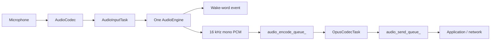

# Audio Service Architecture

`AudioService` owns one input engine and keeps codec I/O, Opus encoding/decoding,
and network queues independent from the chip-specific speech pipeline.

## Input engines

The old `AudioProcessor + WakeWord` combinations have been replaced by a single
`AudioEngine` interface. `AudioInputTask` reads PCM once and feeds exactly one
engine.

| Target | Engine | Wake word | Uplink processing |
| --- | --- | --- | --- |
| ESP32-S3 / ESP32-P4 / ESP32-S31 | `AfeAudioEngine` | WakeNet inside AFE, or MultiNet fed from AFE output | FD AEC + VAD when audio processing is enabled |
| ESP32 / ESP32-C3 / ESP32-C5 / ESP32-C6 | `LiteAudioEngine` | Standalone WakeNet when configured | Raw mono PCM |

`AfeAudioEngine` owns a single FD AFE instance. WakeNet and voice uplink share
that instance, so enabling both no longer creates two AFE pipelines. For custom
MultiNet wake words, AFE fetch output is passed to `CustomWakeWord`; MultiNet is
not created on the smaller targets.

The AFE configuration currently uses `FD_LOW_COST` AEC with
`AEC_NLP_LEVEL_VERYAGGR`. WebRTC/NSNet noise suppression is intentionally
disabled because the project does not ship an NSNet model.

When wake-word audio upload is enabled, the most recent two seconds of PCM are
stored in a single 64 KB PSRAM ring buffer. WakeNet and MultiNet share the same
cache implementation, and the encoder reads it one Opus frame at a time. This
avoids the previous per-chunk internal-SRAM allocations and temporary PCM
concatenation buffer.

## Input data flow

Wake-word detection and voice processing are independent runtime states on the
same engine. On AFE targets, AEC stays active while wake-word detection is active
so playback reference remains available for wake-up during device playback. It
also stays active during voice processing when device AEC is requested.

## Signaling call capture

软件AEC的人际通话由编码任务直接领取16kHz/20ms AFE样本，不再由网络或JPEG事件循环搬运PCM。AFE队列保持48块，编码结果最多四帧并保留一帧在途；结果满时停止取帧，由原事件线程负责UDP/WebRTC发送。发送仍限四帧并逐包收取UDP，批尾才唤醒编码及递交解码，避免每个包之间被算法工作任务抢占；发送另有10ms合作预算，外层八轮另受20ms预算约束，不能因采集任务已武装而提前退出。预算只在原子操作间检查，不是不可抢占的实时上限。空采集经专用条件变量限时等待20ms，关闭须等待工作任务完成，静音/重连以内部代次丢弃迟到结果。

人际通话期间AFE直接交付原生输出块，PCM桥继续组装原有20ms Opus，不再先等待默认60ms聚帧；退出恢复默认聚帧并清除旧段尾样本，在途短块也不能进入旧60ms编码器。编码结果发布后在锁外通知原事件任务，事件任务最多等待原10ms周期，有通知仍至少让出一tick；不提高优先级，也不缩小已经实测需要的四帧结果容量。宿主退出必须先停止人际媒体并等待编码/解码屏障，再解除借用的任务句柄、PCM及端口。

UDP接收端复用单腿接收空间与数据报向量，关闭时归还内存；空轮询不再反复分配和清零2KiB缓冲。长度、截断、包边界及错误语义保持原样。播放任务完成I2S写入与AEC参考后，先在短锁内回投完成票据并快照队列，再在锁外打印统计，慢串口日志不能占住采集共享锁。

恢复人际麦克风前先作废旧编码代次，再重开原PCM采集，清除静音期间源队列、已组帧队列和尾样本；恢复失败继续静音，反向播放及其完成票据保持。静音期间样本不能像AI建连前预录那样在恢复后回放；AI既有提前武装/暂停预录流程保持原样。

PCM桥只对采集起止、组帧和暂停暂存加互斥，播放与完成票据仍归信令事件线程。两方向不共享可变缓冲，格式在构造后不再变化。小智保持原事件线程采集路径；设备媒体协议、Opus格式、AEC、优先级和既有队列上限不变。该结构消除事件循环对取帧的依赖，具体声音连续性和延迟须由实机对照确认。

## Output data flow

## Tasks and power management

- `AudioInputTask` reads codec input and feeds the selected engine.
- `AudioOutputTask` drains decoded PCM to the codec output.
- `OpusCodecTask` encodes uplink PCM and decodes downlink packets.
- `AfeAudioEngine` has its own AFE fetch task on S3/P4/S31.

The audio power timer still enables and disables codec ADC/DAC channels based on
activity; the engine refactor does not change that policy.

## Queue and allocation policy

The service queues use compile-time fixed-capacity storage. Their existing drop,
wait, and playback-drain policies remain unchanged, but queue growth no longer
allocates deque nodes. `AudioTask` values are stored directly, and Opus encoding
writes into the packet payload instead of allocating a second temporary output
buffer. Packet and PCM buffer pools should only be added after target-side heap
and latency measurements justify their additional ownership complexity.

人际视频通话的相机开关按已选驱动处理：UDP只停止／恢复JPEG压缩流，WebRTC沿用H264上行。相机恢复失败保持暂停，不宣告视频已恢复；该操作不清空独立的音频采播队列。

UDP人际视频默认只上送设备画面，不声明对端画面接收能力；空闲上报与实际通话腿选择一致，音频仍双向。JPEG保留原有分片、加密和200ms组帧期限，媒体泵每发送最多两片后处理收包与音频，再发送下一组；发送失败立即中止本帧。设备WebRTC人际视频仍保留对端接收能力。
